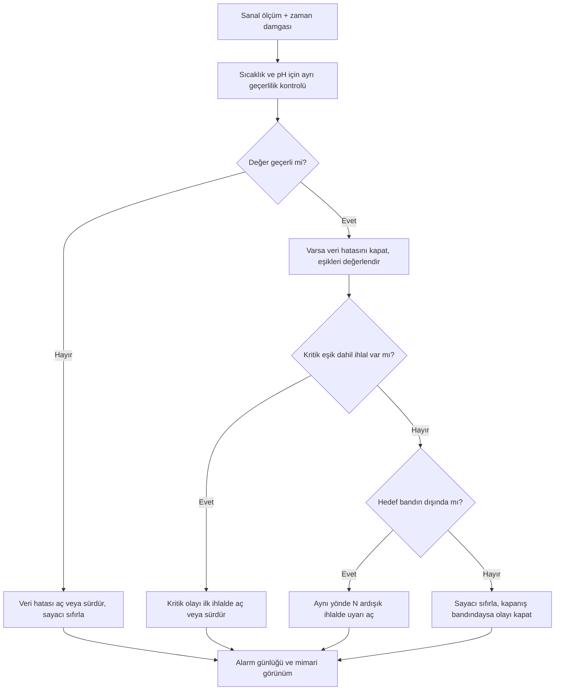

# EEM katkısı — sıcaklık ve pH alarm akışı

ChemFlow Mini MES, tarayıcıda sentetik ölçüm üretir. Paneldeki koruma göstergesi ders demosunun parçasıdır ve yalnızca ekranda durum gösterir.

## Ayarlar ve sınırlar

**Parametreler** sekmesinde sıcaklık ve pH için kritik alt/üst eşik, hedef alt/üst eşik, optimum değer ve histerezis düzenlenir. Ardışık ölçüm sayısı ve örnekleme aralığı da ayarlanabilir. **Uygula** geçerli taslağı devreye alır ve bu tarayıcıya kaydeder.

`kritik alt < hedef alt ≤ optimum ≤ hedef üst < kritik üst`. Hedef bandı pozitif genişlikte olmalı, pH değerleri 0–14 aralığında kalmalıdır. Histerezis her kanal için sıfır ile hedef bant genişliğinin yarısı arasında, üst sınır hariç, seçilir. Ardışık örnek sayısı en az 1, örnekleme aralığı en az 500 ms olmalıdır.

| Demo ayarı | Sıcaklık | pH |
| --- | --- | --- |
| Hedef bant (uçlar dahil) | 60–70 °C | 4,5–5,5 |
| Kritik (eşitlik dahil) | ≤55 veya ≥75 °C | ≤3,8 veya ≥6,2 |
| Histerezis | 0,6 °C | 0,1 |
| Kapanış bandı (uçlar dahil) | 60,6–69,4 °C | 4,6–5,4 |

Tablo başlangıçtaki esterleşme demosunun örnek değerlerini gösterir. Başlangıçta N = 3 ve örnekleme aralığı 1,2 saniyedir. Reaksiyon seçimini, eşiklerin kaynağını ve geçerli çalışma koşullarını kimya ekibi doğrulayacaktır.

## Karar akışı

- **Uyarı.** Hedef bandın dışındaki değer kritik eşiğe ulaşmadıysa aynı kanalda aynı yönde N ardışık örnek gerekir. Yön değişikliği, hedef banda dönüş veya geçersiz veri seriyi keser.
- **Kritik.** Kritik sınırda veya ötesinde ilk geçerli örnek olayı açar. Aktif uyarıyı kritik olay devralır. Aynı ihlal sürerken tek olay gösterilir.
- **Kapanış.** Bir proses alarmı, ölçüm `[hedef alt + histerezis, hedef üst − histerezis]` aralığına girdiğinde kapanır. Kritik ölçüm uyarı bölgesine dönse bile kritik olay bu kapanış bandına kadar tutulur. Operatör onayı olayın görüldüğünü kaydeder. Yeni alarm ayarları uygulandığında açık olaylar ayar değişikliğiyle kapanır ve sayaçlar sıfırlanır.
- **Veri hatası.** Eksik veya sonlu olmayan sıcaklık ve pH ya da 0–14 dışındaki pH, ilgili kanalda ayrı veri hatası açar. İlk geçerli örnek veri hatasını kapatır. Açık proses alarmı geçersiz örnekle kapanmaz ve diğer kanal bağımsız değerlendirilir. Simülatör normalde geçerli ölçüm üretir. Veri hatası, alarm motoruna geçersiz bir örnek geçirilerek sınanır.
- **Enerji anomalisi.** Matematik modelinin mevcut skor eşiği ve ardışık örnek kuralı kullanılır. Skor eşik altına inince olay kapanır. Enerji, maliyet, verim ve OEE hesapları mevcut modelde kalır.

## Demo kontrolü

Varsayılan ayarlarda motor girdileri için örnek beklentiler aşağıdadır. Simülatör yumuşatma uyguladığından elle girilen ofsetin ekrandaki ölçüme etkisi birkaç örnek sürebilir.

| Girdi sırası | Beklenen |
| --- | --- |
| 71 → 72 → 71 °C | Üçüncü örnekte tek sıcaklık uyarısı |
| 71 → 69,8 → 71 °C | Uyarı açılmaz |
| 71 → 59 → 71 °C | Uyarı açılmaz, yön değişiminde seri baştan başlar |
| 75 → 76 → 69,8 → 69 °C | İlk örnekte kritik olay, son örnekte kapanış |
| pH 5,7 → NaN → 15 → 5,8 | Tek veri hatası açılır, ilk geçerli örnekte kapanır ve uyarı serisi birden başlar |
| Aktif uyarıda **Onayla** | Onay kaydedilir, olay kapanış bandına girene dek aktif kalır |
