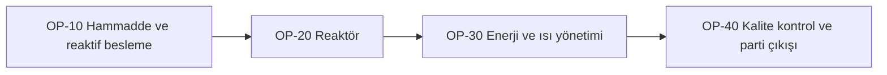

# Endüstri Mühendisliği katkısı: maliyet, OEE ve süreç akışı

## Panel girdileri

| Girdi | Değer | Dayanak |
| --- | --- | --- |
| Elektrik birim fiyatı | 4,81 TL/kWh | Sanayi, tek zamanlı: aktif enerji 2,985253 + dağıtım 1,829503 = 4,814756 TL/kWh. Vergi ve fonlar hariç. Kaynak sayfadaki yürürlük tarihi 4 Nisan 2026 [1] |
| Saatlik duruş maliyeti | 6500 TL/saat | Demo varsayımı. Gerçek tesis verisi değildir |
| Hedef OEE | %85 | Proje hedefi. Yaygın "dünya standardı" referansıdır, kimya sektörüne özgü ölçüt değildir [2] |
| Taban proses enerjisi | 42 kW | Demo varsayımı |
| Nominal parti çıktısı | 1200 kg | Demo varsayımı |

Elektrik fiyatı ikincil bir kaynaktan alınmıştır. Abone grubuna, gerilim seviyesine ve tedarik sözleşmesine göre değişir. Teslimden önce güncel EPDK tarife tablosundan doğrulanmalıdır.

## Formüller

- **Enerji maliyeti (TL)** = tüketim (kWh) × birim fiyat (TL/kWh)
- **Duruş maliyeti (TL)** = duruş süresi (saat) × saatlik duruş maliyeti (TL/saat)
- **OEE** = Kullanılabilirlik × Performans × Kalite

Gerçek tesiste saatlik duruş maliyeti şu kalemlerden hesaplanır: kaybedilen katkı payı + atıl işçilik + yeniden başlatma enerjisi ve fire (saat başına). Kalemler arasında çifte sayım yapılmamalıdır.

## Paneldeki hesap yöntemi

Aşağıdaki katsayılar simülasyon varsayımıdır (`src/engine/processModel.ts`).

- Her ölçüm 1 dakikalık üretim dilimi sayılır. Her kritik ölçüm 1 dakika duruş sayılır.
- Kullanılabilirlik: normal 0,97, uyarı 0,90, kritik 0,62.
- Performans: `1 − max(0, E − E_taban) / 140`, 0,65–1,00 aralığında.
- Kalite: modelin hesapladığı reaksiyon verimi / 100.
- Anlık OEE %35–98 aralığında sınırlanır.
- Hedef OEE karşılaştırma için gösterilir, hesaplanan OEE değerini değiştirmez.

Kritik ölçüm hem 1 dakika duruş sayılır hem de kullanılabilirliğe 0,62 olarak yansır. Bu basitleştirme gerçek OEE ölçümü yerine geçmez. Gerçek ölçümde kullanılabilirlik = çalışma süresi / planlanan üretim süresidir.

## Örnek kontrol

| Durum | Hesap | Sonuç |
| --- | --- | --- |
| 42 kW ile 1 saat çalışma | 42 × 4,81 | 202,02 TL |
| 5 dakika duruş | 5 / 60 × 6500 | 541,67 TL (panelde 542 TL) |
| A = 0,97, P = 1,00, Q = 0,965 | 0,97 × 1,00 × 0,965 | OEE %93,6 |

## Süreç akışı

Bu sıra paneldeki gösterimdir. Isı yönetimi gerçekte reaksiyonla eş zamanlı yürür.

## Kaynaklar

1. Enerji Ajansı, elektrik birim fiyatları: https://enerjiajansi.com.tr/elektrik-birim-fiyatlari/ (erişim: 26 Kasım 2026)
2. Fabrico, OEE benchmarks by industry (yazılım firması blogu): https://www.fabrico.io/tr/blog/oee-benchmarks-by-industry-manufacturing-2026/ (erişim: 26 Kasım 2026)
